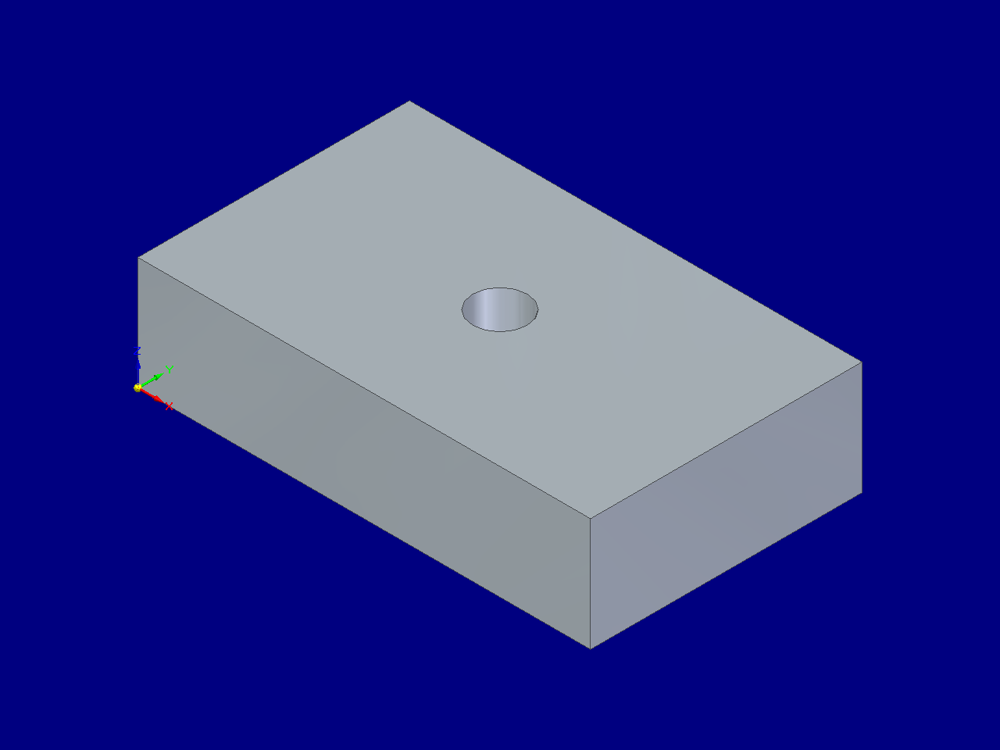

# Solid Edge AI MCP

用自然语言让 AI 操作 Siemens Solid Edge 的 Python MCP 服务。第一版专注有序建模零件（`.par`），采用官方 MCP Python SDK 和 `pywin32`，所有 COM 对象均留在独立 STA 线程。

**23 个工具 · stdio MCP · 毫米输入 · Windows · MIT**

已在 **Solid Edge 2020 / 220.00.00.104、Python 3.12.10 x64** 上通过真实 MCP 客户端完成建模、改厚度、切孔、截图、保存、重新打开和 STEP 导出。其他 Solid Edge 版本尚未验证。



## 快速使用

要求：Windows、已安装并授权的 Solid Edge、Python 3.12。程序本身要求 Python 3.11+，一键脚本固定使用已验证的 3.12。

在项目目录打开 PowerShell：

```powershell
.\scripts\setup.ps1
```

脚本创建项目内 `.venv`，按锁定版本安装依赖，安装本项目，生成实际路径的客户端配置，并检查 Solid Edge 的 COM 注册。本次交付目录已经完成此步骤，可直接使用 `config/` 中的配置。项目搬家后重新运行脚本生成路径。

如 PowerShell 的执行策略阻止本地脚本，可仅对当前脚本进程运行：

```powershell
powershell -NoProfile -ExecutionPolicy Bypass -File .\scripts\setup.ps1
```

### 接入 AI 客户端

- **Codex**：将 `config/codex.toml` 的配置段合并到自己的 `config.toml`，重新加载 MCP 服务。
- **Claude Desktop / Cursor / 其他支持 stdio 的客户端**：使用 `config/mcp.json` 中 `mcpServers.solid-edge` 的配置。
- 配置文件已经填写当前项目 Python 的绝对路径；不要把 JSON 文件整体粘贴进 TOML。
- 服务进程由客户端启动。无需先打开常驻终端，也无需 API Key。

Codex 的工具超时配置为 150 秒，长于服务内部的 120 秒 COM 超时。字段依据 [Codex 官方 MCP 文档](https://developers.openai.com/codex/mcp) 核对。

可给 AI 的第一条指令：

> 连接 Solid Edge，新建一个零件，生成 100×60×20 毫米的长方体；在中心切一个直径 12 毫米的通孔，显示等轴测视图，保存为 plate.par 并导出 plate.step。检查模型体积后把预览图给我。

检查环境或手动启动：

```powershell
.\.venv\Scripts\python.exe -m solid_edge_mcp --doctor
.\scripts\start.ps1
```

`start.ps1` 等待客户端的 JSON-RPC 输入，终端没有普通输出是正常的。日志走 stderr，stdout 只用于 MCP 协议。

## 工具

| 类别 | 工具 |
| --- | --- |
| 连接 | `se_status`、`se_connect`、`se_disconnect` |
| 文档 | `se_list_documents`、`se_get_document`、`se_new_part`、`se_open_document`、`se_close_document` |
| 草图 | `se_reference_planes`、`se_create_rectangle`、`se_create_circle` |
| 实体 | `se_create_box`、`se_create_cylinder`、`se_extrude` |
| 查询和编辑 | `se_geometry`、`se_features`、`se_list_variables`、`se_set_variable`、`se_set_extrusion_depth` |
| 文件 | `se_save_document`、`se_export_step` |
| 视图 | `se_set_view`、`se_capture_viewport` |

还提供 `solidedge://guide` 资源，供客户端读取操作约定。

### 参数约定

- 建模长度使用 **mm**，体积返回 **mm³**。角度变量使用 **deg**。其他变量的 `raw` 值采用 COM 原生单位，并返回 `units_type`，不隐式转换。
- 文档操作必须传 `document_id`。ID 由新建、打开或列举工具返回，断开连接、关闭文档或服务重启后失效。切换活动文档不会改变 ID 所指向的零件。
- 草图坐标是指定基准面内的局部坐标。基准面索引从 **1** 开始；调用 `se_reference_planes` 查询实际名称。默认模板的第 1 面在本机是 XY 面。
- `se_create_box` 的宽、深沿平面局部轴，高沿平面法向；`se_create_cylinder` 同样从平面原点沿法向拉伸。两者只用于空零件。
- 在已有实体上加料或切除：先建矩形/圆轮廓，再 `se_extrude(operation="add" / "cut")`；轮廓使用后失效。第一版只支持有序、单实体零件。
- 修改拉伸厚度使用 `se_set_extrusion_depth`，`feature_name` 来自 `se_features`。2020 版不一定将拉伸深度自动列入变量表。
- `se_set_variable` 要求名字和单位与查询结果一致。写入会改变原有变量驱动值；有关联公式的零件应先查看返回的 `formula`。
- `se_set_view` 支持 `Iso`、`Front`、`Top`、`Right`。截图工具会保存 PNG，并将 MCP 图像内容直接返回给 AI。

## 输出与错误行为

客户端配置默认把 CAD 文件写入项目内 `data/`。也可使用 `--output-dir` 或环境变量 `SOLIDEDGE_MCP_OUTPUT_DIR` 指定根目录；命令行参数优先。

- 打开文件需提供已有 `.par` 的绝对路径；保存、导出、截图必须位于输出根目录内。
- 已有文件（包括原位保存）必须传 `overwrite=true`。外部打开的零件可另存到输出目录，不能直接覆盖目录外的原件。
- 关闭含未保存修改的文档会失败，除非已保存或明确传 `discard_changes=true`。
- `se_disconnect` 和 MCP 退出只释放连接，不退出 Solid Edge，不自动保存或关闭用户文档。
- 建模不只检查 COM 是否返回：拉伸和切除后读取实体体积，确认加料/减料确实发生；深度和变量修改后读取实际值。保存/导出检查文件非空，STEP 导出保留原生文件路径。
- COM 操作不具备事务回滚。操作报错可能已留下草图或部分特征；超时后操作也可能继续完成。先检查模型，不能自动重复写入。工作线程忙时拒绝新请求，避免任务堆积。
- `se_features` 返回 Solid Edge 原始状态码：`1216476310` 为 OK，`1216476311` 为失败，`1216476312` 为警告。修改参数后应检查下游特征。
- 本服务使用本机用户权限，通过固定工具调用 COM；未开放任意脚本、Shell 或任意成员执行入口，也未开放 HTTP 监听端口。

## 验证

```powershell
.\scripts\setup.ps1 -Dev
.\.venv\Scripts\python.exe -m pytest -q
.\.venv\Scripts\ruff.exe check .
.\.venv\Scripts\ruff.exe format --check .
```

15 项自动化测试覆盖：真实 stdio 握手与工具发现、非法参数和错误响应、输出路径和覆盖保护、文档 ID 失效、跨文档轮廓拒绝、未保存文档保护、COM 单线程生命周期、超时不重试写入、线程退出清理等。

有 Solid Edge 的 Windows 机器可运行实机测试：

```powershell
.\.venv\Scripts\python.exe .\scripts\live_smoke.py --keep-open
```

它创建独立测试零件和带时间戳的输出目录；只关闭本次创建的文档。`--keep-open` 在成功后保留演示板。没有该选项时测试结束会关闭自己的文档。

实机记录见 [VALIDATION.md](VALIDATION.md)，完整调用结果见 [verification.json](examples/demo/verification.json)。本次检查通过全部 23 个工具的调用，不代表全部参数组合或全部 Solid Edge 版本均已测试。

## 项目结构

```text
src/solid_edge_mcp/
  server.py       MCP 工具、参数 Schema、资源和生命周期
  worker.py       STA 线程、超时与退出处理
  backend.py      Solid Edge 2020 COM 实现
  paths.py        输出目录、覆盖保护和文件验证
  __main__.py     stdio 启动与环境诊断
scripts/          安装、启动、配置生成与实机测试
tests/            不需要启动 Solid Edge 的回归测试
config/           当前机器可直接使用的客户端配置
examples/demo/    实际生成的零件、STEP、PNG 和验证记录
```

当前不包含装配约束、工程图、钣金、倒角/圆角、放样/扫掠或同步建模工具。后续可沿 `backend.py` 增加 COM 实现，再在 `server.py` 注册明确参数的工具，并补相应实机验证。

参考项目、提交号和许可证见 [THIRD_PARTY_NOTICES.md](THIRD_PARTY_NOTICES.md)。
